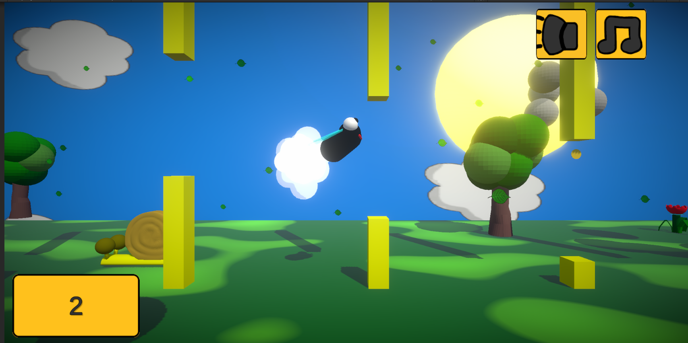
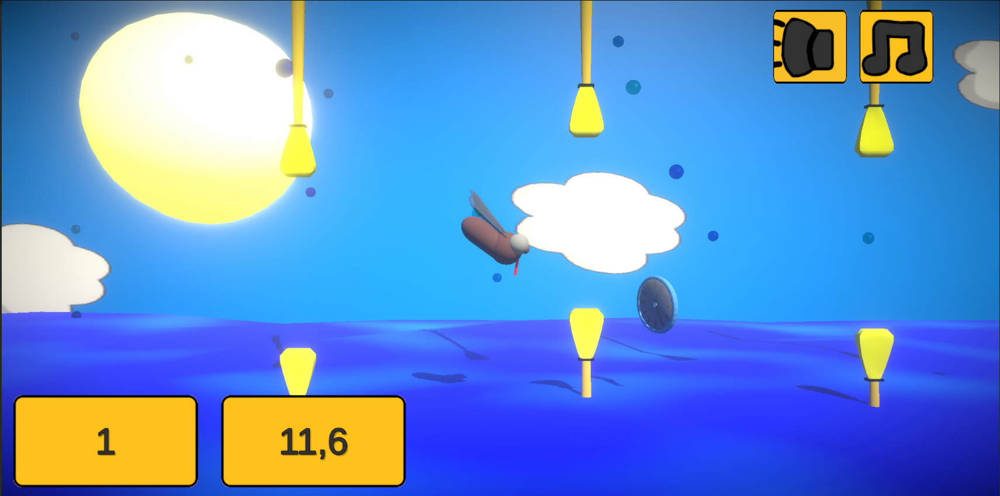
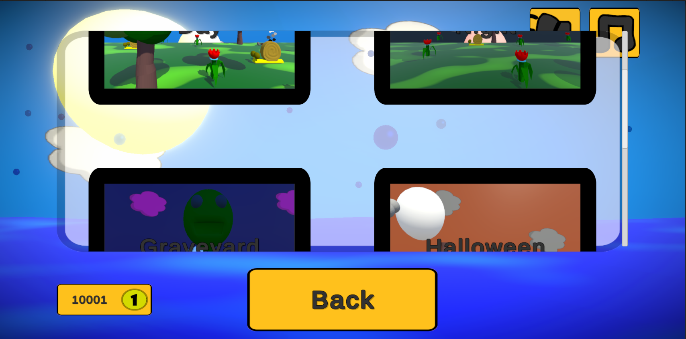
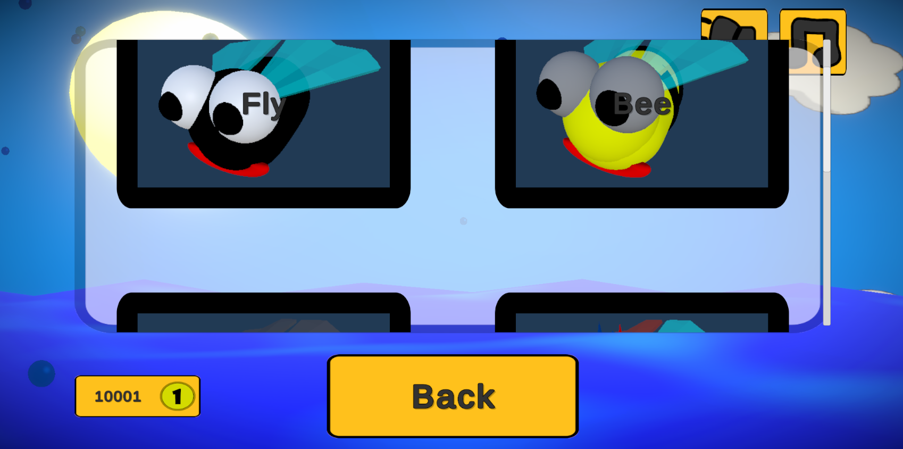

# FlyHigh!

Trójwymiarowa gra w stylu Flappy Bird od Szymucha (wersja 0.3). Gracz steruje muchą, omija przeszkody i zbiera punkty. Za monety kupuje nowe skórki, a po lepszych wynikach odblokowuje kolejne tryby.

## Sterowanie

- **Spacja** albo **dotknięcie ekranu** podbija postać w górę.
- Mucha przechyla się sama: nos idzie w górę przy wznoszeniu i w dół przy opadaniu.
- Zderzenie z przeszkodą kończy rundę.

## Rozgrywka

Świat przesuwa się w lewo. Gracz dostaje punkty za przelot przez bramkę i za zebraną monetę. Moneta dodaje też walutę do sklepu. Najlepszy wynik każdego trybu zostaje zapisany.

Wraz z wynikiem pojawiają się nowe przeszkody: zwykłe i szerokie słupy, bariery obrócone albo poruszające się w pionie i w poziomie, a także ptaki. Ptak po zbliżeniu muchy leci dwa razy szybciej.

Przyciski w rogu ekranu wyciszają muzykę i efekty.

## Tryby

| Tryb | Jak odblokować |
| --- | --- |
| Classic | dostępny od początku |
| Time | 30 punktów w Classic |
| Crazy | 50 punktów w Classic |
| Crazy Time Attack | 50 punktów w Crazy |

W trybach na czas obok wyniku widać licznik.

## Sklep

**Światy:** Day, Night, Graveyard, Halloween, Ocean i Candyland.

**Skórki:** od startu są Fly, Bee i Fly's Girl. Za monety gracz dokupuje Mosquito, Rock i Flar.

## Uruchomienie

Projekt jest w Unity **2022.3.44f1** (Universal Render Pipeline). Folder `FlappyMucha` otwiera się jako projekt, a scena startowa to `Assets/Scenes/SampleScene.unity`.

## Autorzy

- Kod i większość grafiki: [Szymucha](https://www.youtube.com/@Szymucha)
- Muzyka (utwory 1–3): [MUSTI](https://www.youtube.com/@MustaczSosik)
- Efekty dźwiękowe: RPG Essentials, Leohpaz
- Dynia i lizak: Naatiia

## Zrzuty ekranu

Gra jest gotowa do lotu.
